# Administrative Units in Microsoft 365 and Microsoft Entra ID

An administrative unit (AU) lets you give someone admin rights over **one part of an organisation** instead of the whole company. In this lab I created an AU for a made-up Birmingham office, gave two people limited admin roles inside it, and set up a back-up admin for when the main one is away.

## About this lab

I did this lab in my own Microsoft 365 tenant while working through the administrative units module of my SC-300 (Microsoft Identity and Access Administrator) course at QA. The course shows the idea; the build, the screenshots and these notes are mine.

**Licence used:** Microsoft 365 Premium (paid subscription). The users are made-up test accounts.

## Goal

Practise limiting admin power to one office. A help desk admin in Birmingham should be able to help Birmingham users, not everyone in the company.

## What I built

- An administrative unit called **Birmingham Office** (description: England Regional Office)
- Five test users and two groups (Sales and HelpDesk) added as members
- **Scoped roles:** one user as User Administrator and one as Helpdesk Administrator, both limited to this unit
- A **back-up User Administrator** to cover the main admin's absence

## Steps

### 1. Start a new administrative unit
In the Microsoft 365 admin centre I opened **Roles**, then **Administrative units**, and chose **Add unit**.

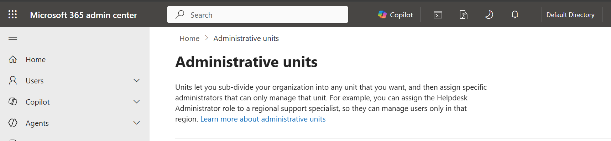

### 2. Name the unit
I named it **Birmingham Office** with the description **England Regional Office**.

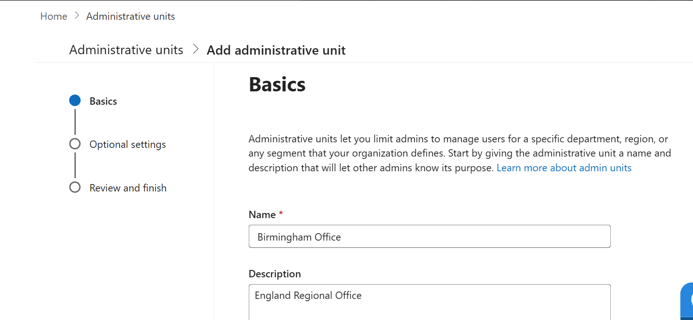

### 3. Add members
Members can be added by hand (up to 20 users and groups at a time) or from a text file (up to 200 users). I added them by hand.

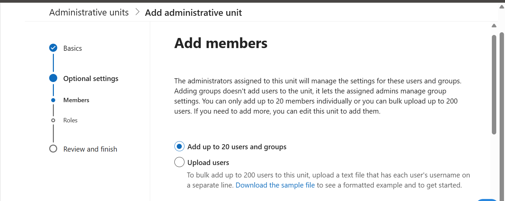

I picked five test users.

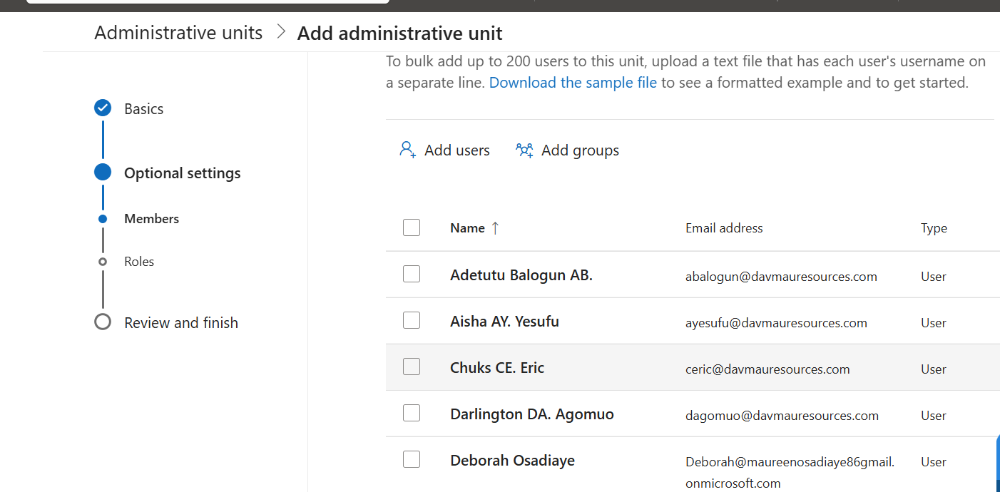

I then added two groups, Sales and HelpDesk.

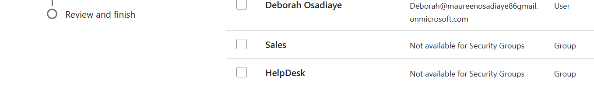

### 4. Assign scoped admin roles
I chose the **User Administrator** role.

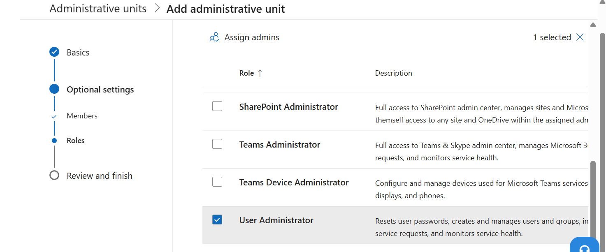

I assigned **Aisha** to it.

I then assigned **Balogun** to **Helpdesk Administrator**.

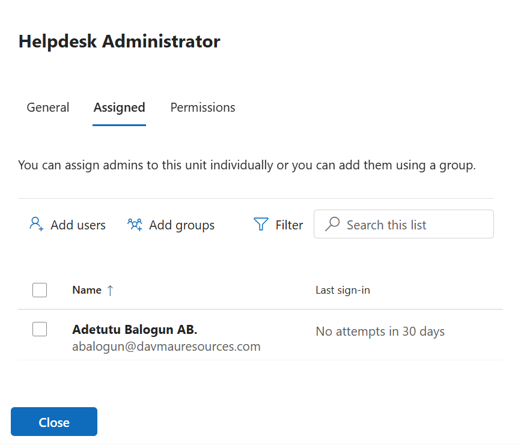

The Permissions tab lists exactly what a role can do, which I read before assigning it.

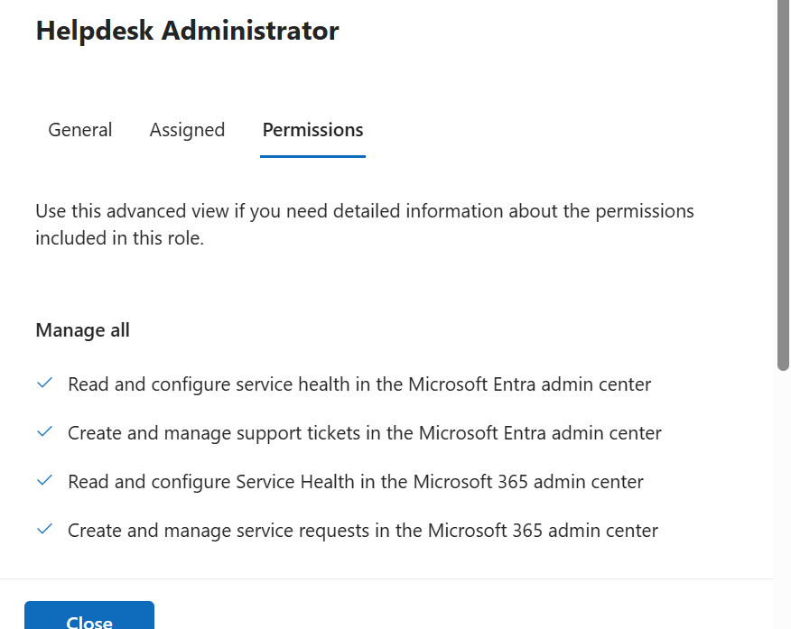

### 5. Review and create
The review page showed the name, description and members (5 users, 2 groups). I checked it and chose **Add**.

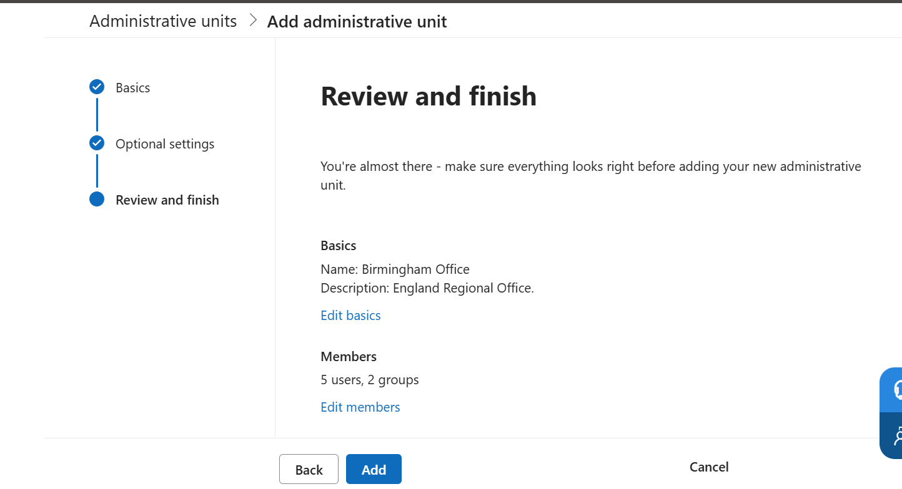

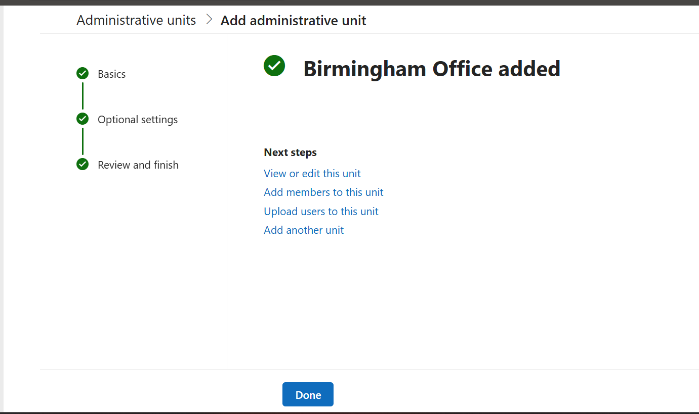

### 6. Check it in the Entra admin centre
The same unit shows in the Microsoft Entra admin centre under **Administrative units**, with its users, groups and roles.

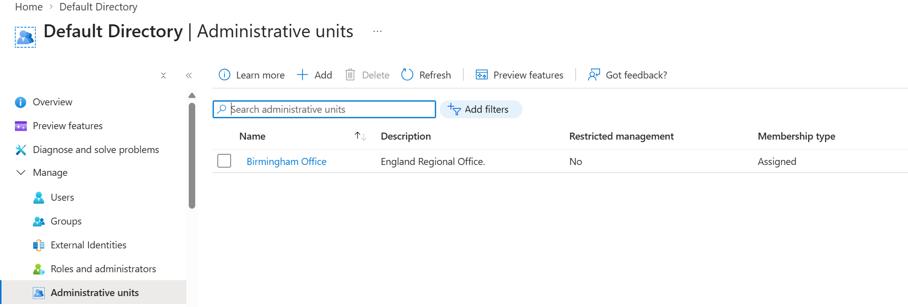

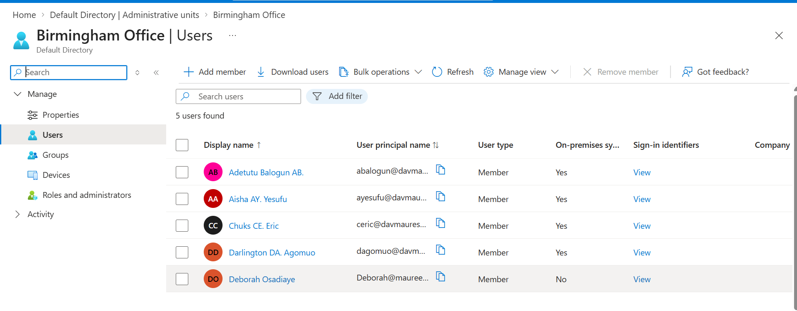

### 7. Add a back-up User Administrator
In the unit's **Roles and administrators**, I added a second User Administrator (Chuks) so the unit has cover when the main admin, Aisha, is away.

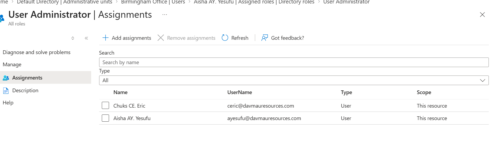

## Result

The Birmingham Office unit was created, and its members and role assignments appeared in both admin centres. The admins' rights apply only to the people and groups inside the unit.

## What I learned

- Administrative units are for **limiting** admin rights to part of the organisation, such as an office, a region or a department.
- Roles can be assigned to a unit, so a Helpdesk Administrator for one office does not get rights over the rest of the company.
- The same unit can be managed from either the Microsoft 365 admin centre or the Entra admin centre.
- Having a second person assigned to a role is a simple way to arrange cover when someone is away.

## Not covered

The course also mentions **dynamic membership** (members added automatically by rules). I did not see that option in my tenant, so I did not cover it here.

## Skills shown

Microsoft 365 admin centre, Microsoft Entra ID, administrative units, role-based access, least privilege, user and group management.
